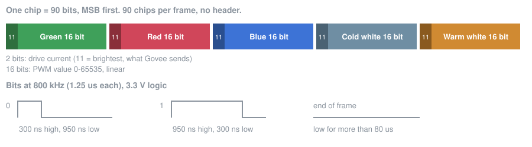

<h1 align="center">Govee TV Backlight 3 Pro on an ESP32</h1>

<p align="center">
  <b>Run the LED strip of the Govee TV Backlight 3 Pro and 3S Pro (H66A0, H66A1) from your own ESP32, without the Govee box, camera or cloud.</b><br>
  Local ambilight from Hyperion or HyperHDR over DDP, 16 bits per channel, and the strip's protocol written down so WLED can support it too.
</p>

<p align="center">
  <a href="https://owen282000.github.io/govee-tv-backlight-esp32/"></a>
  <a href="https://github.com/owen282000/govee-tv-backlight-esp32/releases/latest"></a>
  <a href="https://github.com/owen282000/govee-tv-backlight-esp32/actions/workflows/build.yml"></a>
  <a href="LICENSE"></a>
  
  
  
</p>

<p align="center">
  <a href="https://owen282000.github.io/govee-tv-backlight-esp32/"><b>Install</b></a>
  &nbsp;·&nbsp;
  <a href="#quick-start">Quick&nbsp;start</a>
  &nbsp;·&nbsp;
  <a href="docs/protocol.md">Protocol</a>
  &nbsp;·&nbsp;
  <a href="#compatibility">Compatibility</a>
  &nbsp;·&nbsp;
  <a href="#wiring">Wiring</a>
  &nbsp;·&nbsp;
  <a href="#hyperion">Hyperion</a>
  &nbsp;·&nbsp;
  <a href="#for-wled">WLED</a>
</p>

<p align="center">
  <a href="docs/protocol.md"></a>
  <br>
  <sub>What the Govee box sends to each of the 90 chips, measured with a logic analyzer. More in <a href="docs/protocol.md">the protocol write-up</a>.</sub>
</p>

The Govee TV Backlight 3 Pro has no local API. There's no LAN control in the Govee app for it, Matter only gives you on, off and one color, it ignores the known Govee Bluetooth commands, and DreamView only works through the box's own camera. The strip itself is fine, though, and it plugs into the box with USB-C. So this project leaves the strip as it is and replaces the box: an ESP32 speaks the strip's protocol, which I measured with a logic analyzer on the original controller. Plug the strip back into the Govee box and everything is as before.

## What you get

- **The strip without the box.** All five channels (red, green, blue, cold white, warm white) at 16 bits each, on any ESP32.
- **Local ambilight, no camera.** The firmware takes DDP, so Hyperion, HyperHDR or anything else that speaks DDP can drive the strip directly. I run it at 30 frames a second, with no cloud in between.
- **Smooth dark scenes.** Gamma happens on the ESP32 in 16 bits instead of 8, so dim colors don't step.
- **Install from your browser.** Flash an ESP32 over USB from the [web installer](https://owen282000.github.io/govee-tv-backlight-esp32/) and set up Wi-Fi straight after, no toolchain needed. A Gledopto that runs WLED takes the update over the air, and sets up Wi-Fi from your phone.
- **A simple interface.** Set a color, a white or a test pattern over HTTP or USB serial, and update the firmware over the air. Settings survive a restart.
- **The protocol, documented.** [docs/protocol.md](docs/protocol.md) has the pinout, the timing and the bit layout, with a raw capture of the original controller in [captures/](captures/). WLED can't drive this strip yet, and that write-up is what it needs.

## How it works

```
TV picture ──> Hyperion ──DDP over Wi-Fi──> ESP32 ──one data wire──> Govee strip
                                              ^
                       HTTP / serial ─────────┘   (static colors, tests, OTA)
```

The strip is a chain of 90 chips on one data wire at 800 kHz, like a WS2812, but each chip takes 90 bits: five channels of 2 current bits and a 16-bit value. The ESP32's RMT peripheral generates that timing exactly. When DDP comes in, the strip shows it; three seconds after the last DDP packet it falls back to the static color you set over HTTP, or off.

## What you need

| Part | Notes |
| --- | --- |
| An ESP32 | Any dev board works. I use a **Gledopto GL-C-015WL-M**, an ESP32 WLED controller with a 5-24 V input, lever terminals and a case, so it runs straight off the Govee adapter. |
| A USB-C male-and-female breakout | A "USB-C 3.1 male and female to DIP" board with all pins wired straight through and broken out to headers. The strip plugs into it, and you solder your wires to the pins. Keep the Govee box untouched. |
| The Govee 12 V adapter | 12 V, 3 A. Into the Gledopto's DC jack, or into a DC jack screw terminal for a bare dev board. |
| Wire | 0.75 mm² for 12 V and ground (up to 3 A), anything for data. |
| Optional | A multimeter and a cheap 24 MHz logic analyzer, to check your strip before you connect it. |

## Compatibility

| Govee model | Sold as | Strip | Status |
| --- | --- | --- | --- |
| **H66A0** (55-65") | TV Backlight 3 Pro, TV Backlight 3S Pro, retail code R2A80 | RGBWWIC, 16 bit, 90 chips on a 65" TV | **Tested** |
| **H66A1** (75-85") | TV Backlight 3 Pro, TV Backlight 3S Pro, retail code R2A81 | Same strip type, longer | Likely to work with `chips` set to your count. Untested, reports welcome |
| Strip Light 2 Pro | | Same 90-bit chip ("G1151"), 24 V | Same protocol by the look of [WLED #5919](https://github.com/wled/WLED/pull/5919), different voltage. Untested |
| H2A40/H2A41 (TV Backlight 3), H6099 (3 Lite), H6098 (3S), H605C (Envisual T2), H6199 (DreamView T1) | | RGBWIC, RGBICW or RGBIC | Different strips, so probably a different protocol. Not supported |

Checking your own strip takes ten minutes with a multimeter and the breakout, see step 1 of the quick start. If your model works, an issue with what you measured adds it to this table.

## Quick start

1. **Check your strip** (optional, but it takes ten minutes). Put the breakout between the Govee box and the strip, set a solid color in the Govee app and measure every pin against GND. You should find 12 V on VBUS, CC1 and CC2, and the data line on A10/B10 at a fraction of a volt. [The protocol page](docs/protocol.md#pinout) has the full table.
2. **Install the firmware**, one of three ways:
   - **From your browser:** open the [web installer](https://owen282000.github.io/govee-tv-backlight-esp32/) in Chrome or Edge on a computer, connect the ESP32 with a USB data cable and press Install. When it's done it asks for your Wi-Fi network and shows the board's address. If it says *Failed to initialize*, hold the board's **BOOT** button while you click Install and let go once the progress bar starts; many dev boards need that.
   - **A Gledopto that still runs WLED, no cable:** download `govee-tv-backlight-gledopto-ota.bin` from the [latest release](https://github.com/owen282000/govee-tv-backlight-esp32/releases/latest) and upload it in WLED under **Config**, **Security & Updates**, **Manual OTA update** (tested with WLED 0.15.1). The board restarts with its own Wi-Fi network `govee-backlight-xxxx`, password `backlight`. Join it with your phone, the setup page opens (or go to `http://192.168.4.1`), and pick your network. To go back to WLED later, upload a WLED binary through `/update`.
   - **Build it yourself** with [PlatformIO](https://platformio.org/): `pio run -d firmware -e esp32dev -t upload` (or `-e gledopto`). Put your Wi-Fi in `firmware/include/secrets.h` (copy the example), or set it up afterwards like the other two ways.
3. **Wire it up** with the adapter unplugged, see [Wiring](#wiring).
4. **Plug in the adapter and test.** The strip stays dark at power-up. Then:
   ```sh
   curl "http://govee-backlight-xxxx.local/cmd?q=test"
   ```
   runs red, green, blue, cold white, warm white and off, a second each. Use the board's IP address if `.local` names don't resolve on your network. The [commands](#commands) are below.
5. **Point Hyperion at it**, see [Hyperion](#hyperion).

## Wiring

| From | To the breakout |
| --- | --- |
| Adapter + (or the Gledopto's **V**) | **VCC** (VBUS) |
| Adapter - (or the Gledopto's **G**) | **GND** |
| ESP32 GPIO 16 (the Gledopto's **D** next to GPIO16) | **A10** |
| VCC | **A5** and **B5** (the Govee box puts 12 V there too) |
| ESP32 GND (the Gledopto shares it already) | **GND** |

- **Never connect the data pin or a logic analyzer to VCC, A5 or B5.** That's 12 V.
- The strip only uses one row of the plug, depending on which way round it's in. Data on A10 is enough; if the strip stays dark, turn the strip's plug over in the breakout.
- A2, A3, B2 and B3 sit at 3.3 V on the Govee box but aren't needed.
- The Gledopto's data output is 5 V and the Govee box uses 3.3 V. The strip takes both.
- Jumper wires are fine for a test at low brightness (`max 0.25`). For full brightness solder 0.75 mm² wire for 12 V and GND.

## Commands

Over USB serial (115200 baud, see [`tools/serial_cmd.py`](tools/serial_cmd.py)) or over HTTP as `http://<ip>/cmd?q=<command>`. Every command answers with the current state as JSON; `http://<ip>/` gives the state alone. `chips`, `max`, `prefix`, the Wi-Fi network and the OTA password are kept in flash and survive a restart.

| Command | What it does |
| --- | --- |
| `c g r b cw ww` | All chips to these values, 0-65535 per channel, in wire order |
| `rgb r g b` | A color in 0-255, with gamma 2.2 |
| `off` | Everything off |
| `test` | Red, green, blue, cold white, warm white, off, a second each |
| `chips n` | Number of chips (default 90) |
| `max 0.0-1.0` | Upper limit per channel (default 1.0), for example 0.25 while testing on thin wires |
| `prefix 0-3` | The current bits in front of each channel (default 3, the brightest) |
| `otapass <password>` | Switch on over-the-air updates with this password (8 characters or more). Over HTTP only the first time, after that only over serial |
| `restart` | Restart the board |
| `forget` | Forget the Wi-Fi network and restart into setup mode. Serial only |
| `status` | The current state |

**DDP** on UDP port 4048: RGB per pixel, pixel *n* goes to chip *n*.

**Over-the-air updates** are off until you set a password with `otapass` (or `OTA_PASS` in `secrets.h`). Then upload the `-ota.bin` of a release, or your own build:

```sh
curl -u ota:<password> -F "update=@govee-tv-backlight-gledopto-ota.bin" http://<ip>/update
```

**No Wi-Fi?** Without a saved network, or when the saved one is out of reach for two minutes, the board opens its own network `govee-backlight-xxxx` (password `backlight`) with a setup page at `http://192.168.4.1`. It keeps trying the saved network meanwhile and closes the setup network once it's back.

## Hyperion

In Hyperion, add an LED hardware device of type **udpddp** with the ESP32's IP and port 4048, and set the LED count to the number of chips. Two things to get right:

- **Gamma 1.0 for these LEDs.** The firmware already applies gamma 2.2, in 16 bits. With Hyperion's default 2.2 on top, everything looks too dark. If the strip shares a Hyperion instance with other lights, give it its own color adjustment with its own LED range.
- **The layout.** Run [`tools/ddp_pattern.py <esp32-ip>`](tools/ddp_pattern.py): chip 1 lights red, every tenth chip green, the last chip blue. Note where red starts and which way the greens run, then build the layout in Hyperion. On my 65" TV the strip starts at the bottom of the right side and runs counter-clockwise seen from the front: 15 chips up the right side, 30 across the top, 16 down the left side and 29 along the bottom.

## Home Assistant

There's no Home Assistant entity in the firmware itself yet. Two ways that work today:

- **A `rest_command`** that calls `http://<ip>/cmd?q=c ...` from scripts and automations.
- **What I do:** a small bridge next to Hyperion publishes the strip as an MQTT light (RGBWW, 2700-6500 K) and sends its state to the ESP32 over HTTP, so the backlight works with scenes and automations when the TV is off, and Hyperion takes over when it's on.

MQTT discovery in the firmware is the obvious next step. Pull requests welcome.

## How the protocol was found

There is no datasheet: the chips on the strip are unmarked. I put a USB-C male-and-female breakout between the Govee box and the strip, found the 12 V and data pins with a multimeter, and recorded the data pin with a 24 MHz logic analyzer and `sigrok-cli` while switching colors in the Govee app. A decoder ([`tools/decode_capture.py`](tools/decode_capture.py)) turned the pulses into 90 identical 90-bit chips, and switching one color at a time gave the channel order. Then the reverse: this firmware on an ESP32, its output captured and decoded the same way, bit for bit equal to the Govee box before it went near the strip. Changing only the 2 bits in front of each channel showed what they do. [docs/protocol.md](docs/protocol.md) has every step, and [captures/](captures/) the raw recording.

## For WLED

As far as I know WLED can't drive this strip yet. [Pull request #5919](https://github.com/wled/WLED/pull/5919) adds the Govee Strip Light 2 Pro, whose "G1151" chips take the same 90 bits, but its layout was found by trial and error. Measured on the original controller, each channel is **2 current bits followed by 16 bits of value**, not 5 x 16 bits with 10 control bits at the end. [docs/protocol.md](docs/protocol.md#why-this-matters-for-wled) has the details and the capture.

## Safety

- The strip runs on 12 V at up to 3 A. Use the Govee adapter or one with the same rating, and wire that can carry it.
- Unplug the adapter before you change any wiring.
- The HTTP interface has no login. Keep the ESP32 on a network you trust, such as an IoT VLAN, and set an OTA password.
- The setup network uses a fixed password (`backlight`) and is only up while the board has no working Wi-Fi.
- This is my own work, not Govee's. It doesn't modify the Govee box, but it's your hardware and your risk.

## Help and contributing

Bugs and questions go to [issues](../../issues). Got a different Govee strip on a logic analyzer? A capture and a few lines on what you measured help the most: open an issue, attach the `.sr` file, and I'll add it to the protocol page. Pull requests are welcome.

## Support the project

Stars, shares and good bug reports all help. If you want to chip in for the evenings that go into it, there's [Ko-fi](https://ko-fi.com/owen282000). The firmware stays free and open source (MIT) either way.

MIT licensed. See [LICENSE](LICENSE).

<p align="center">
  <sub>Made by <a href="https://github.com/owen282000">Owen Vogelaar</a> for the self-hosting and home automation crowd.</sub><br>
  <sub>Govee and DreamView are trademarks of their owner. This project is not affiliated with or endorsed by Govee.</sub>
</p>
