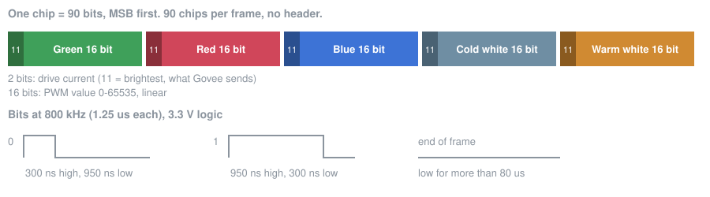

# The strip protocol

How the Govee TV Backlight 3 Pro (H66A0, also sold as TV Backlight 3S Pro, retail code R2A80) controller box talks to its LED strip, measured on 11 November 2026 with a logic analyzer on the original controller. Nothing here comes from Govee documentation; there is none.

## Hardware

- **Controller box:** label "Govee TV Backlight 3S Pro", model R2A80 (the retail code for the H66A0, 55-65"), 12 V, 3 A, 30 W. A round DC jack for the power adapter and two USB-C ports: one for the camera (the right-angle plug) and one for the strip (the straight plug).
- **Strip:** RGBWWIC, with an unmarked 8-pin SOP chip per group of LEDs. My strip runs around the back of a 65" TV and has **90 chips**, each driving a group of three LEDs.
- **Connector:** USB-C, but not USB. Govee uses it as a cheap connector with enough pins.

## Pinout

Measured with a USB-C male-to-female breakout between the box and the strip, the box powered and set to solid red, multimeter on DC volts against GND. The A and B rows read the same, so the plug works both ways round.

| Pin (USB-C name) | Reading | Function |
| --- | --- | --- |
| VBUS (A4, A9, B4, B9) | 11.75 V | 12 V supply |
| CC1 / CC2 (A5, B5) | 11.83 V | Also 12 V. I connect it to the supply as the box does. |
| A10 / B10 (RX2- / RX1- in USB 3 terms) | 0.72 V average | **Data**, 3.3 V logic |
| A2, A3 / B2, B3 (TX1+, TX1- / TX2+, TX2-) | 3.33 V and 3.18 V, constant | No activity seen. Not needed to drive the strip. |
| D+, D-, A8, B8 (SBU), A11, B11 | 0 V | Not used |
| GND (A1, A12, B1, B12) | 0 V | Ground |

## Signal

- **Single wire, 800 kHz NRZ**, like a WS2812: every bit is a high pulse followed by a low, 1.25 us in total. A short high pulse (about 300 ns) is a 0, a long one (about 950 ns) is a 1. The analyzer, sampling at 24 MHz, saw high pulses of 294-336 ns and 924-966 ns and nothing else.
- **Frame:** 8100 bits = 90 chips of 90 bits, no header, then the line stays low until the next frame. The box sends a frame every 21 ms (about 48 per second), also when nothing changes.
- **Chip:** five channels in the order **green, red, blue, cold white, warm white**. Each channel is **2 current bits followed by a 16-bit value**, most significant bit first.
- **Brightness is linear** in the 16-bit value: red at 50% in the Govee app arrives as 32767. The box does its own fades between colors over a few frames.

### The two current bits

The Govee controller always sends `11`. Driving the strip myself with the same color and only these two bits changed:

| Bits | Result |
| --- | --- |
| `11` | Brightest, what the Govee controller sends |
| `10` | A little dimmer |
| `01` | Dimmer again |
| `00` | Dimmest, but still on |

So they set the drive current per channel, in four steps. Firmware should send `11` unless it wants a lower ceiling.

### Why this matters for WLED

The same 90-bit chip shows up in other Govee strips. [WLED pull request #5919](https://github.com/wled/WLED/pull/5919) adds a type for the Govee Strip Light 2 Pro that sends 5 x 16 bits followed by 10 "control bits" set to 0, found by trial and error without an analyzer. Measured on the original controller, those 10 bits are not a block at the end: they are the five pairs of current bits, one in front of each channel. Sending 16-bit values with 10 zeros at the end misaligns every channel: the chip reads the top 2 bits of each value as the current setting and the rest shifts along, which may explain some of the odd colors and dim red people report with these strips.

## What the box sends per color

Values per chip as decoded from the data line while switching colors in the Govee app (all 90 chips identical each time). The middle rows are the box's own fades.

| Color in the app | G | R | B | Cold white | Warm white |
| --- | --- | --- | --- | --- | --- |
| Red | 82 | 65535 | 0 | 0 | 0 |
| Green | 65535 | 0 | 0 | 0 | 0 |
| Blue | 0 | 0 | 65535 | 0 | 0 |
| White | 0 | 0 | 0 | 65535 | 0 |
| Warm white | 0 | 0 | 0 | 0 | 65535 |
| Cold white | 0 | 0 | 0 | 65535 | 0 |
| Red at 50% | 0 | 32767 | 0 | 0 | 0 |

The current bits were `11` in every frame.

## How it was measured

- A USB-C 3.1 male-and-female breakout board (pins wired straight through and broken out to headers), so the strip kept working while I measured.
- A multimeter for the pinout, then a 24 MHz 8-channel logic analyzer (the common Saleae clone) on A10, sampling with `sigrok-cli` and the fx2lafw firmware. No level shifter needed: the data line is 3.3 V.
- [`tools/decode_capture.py`](../tools/decode_capture.py) turns a capture into the table above. The raw capture of the original controller showing red is in [`captures/`](../captures/).
- Then the reverse: this firmware on an ESP32, its output captured and decoded the same way, bit for bit equal to the Govee box before it went near the strip.
